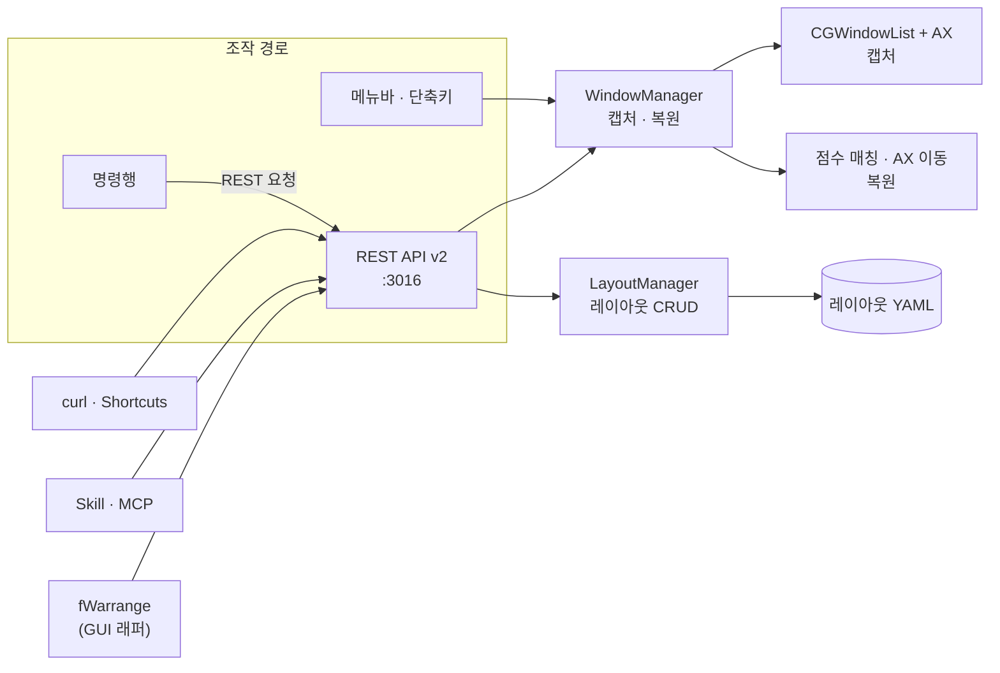

# 개요

fWarrangeCli 는 macOS 의 창 위치·크기를 YAML 로 저장하고, 앱이 다시 실행되어 창 ID 가 바뀌어도 점수 기반 매칭으로 원래 자리를 찾아 되돌리는 **창 레이아웃 엔진**입니다. 메뉴바에 상주하는 헬퍼 데몬이며 메뉴바 · 전역 단축키 · 명령행 · REST API(`/api/v2`) · Skill · MCP 로 조작합니다.

> **fWarrange 는 fWarrangeCli 의 GUI 래퍼입니다.** App Store 앱 fWarrange 는 창을 직접 다루지 않고 이 문서의 REST API 를 호출해 레이아웃 목록 · 미니맵 · 설정 창을 보여 줍니다. GUI 사용법은 [fWarrange 안내 페이지](https://finfra.kr/product/fWarrange/kr/index.html)에 있습니다.

이 문서는 기능 단위 명세입니다. 사용 절차는 [kr/](kr/01_Overview.md) · [en/](en/01_Overview.md) 매뉴얼을, 엔드포인트의 정확한 계약은 [`api/openapi_v2.yaml`](../api/openapi_v2.yaml) 을 따릅니다.



# 1. 레이아웃 캡처

## 1.1. 창 열거 — CGWindowList + 손쉬운 사용 API 하이브리드

* `CGWindowListCopyWindowInfo` 로 화면의 창을 빠르게 열거합니다. 레이어 0(일반 창)만 대상이며, 메뉴바·툴팁 같은 비대화형 요소는 빠집니다
* 창 제목은 손쉬운 사용(Accessibility) API 로 다시 읽어 정확한 값을 씁니다. 창 ID ↔ `AXUIElement` 대응은 비공개 API `_AXUIElementGetWindow` 로 구합니다
* 제외 앱(`excludedApps`, 기본 `Activity Monitor` · `System Settings`)은 캡처·복원 모두에서 빠집니다
* 요청에 `filterApps` 를 주면 그 앱의 창만 저장합니다

## 1.2. 레이아웃 이름

* 생략하면 `default` (메뉴바 저장은 `YYYY-MM-DD-N` 자동 이름)
* 경로 구성요소 하나여야 합니다 — `/` 포함 · 빈 문자열 · `.` · `..` · `이름.yml` 이 255바이트 초과면 `400` 으로 거부합니다

## 1.3. YAML 형식

레이아웃 파일은 창 정보 배열 하나입니다. 이름·저장 시각은 파일 이름·파일 시스템에서 얻습니다.

```yaml
- app: "Safari"                 # 창 소유 앱 이름
  bundleId: "com.apple.Safari"  # 선택 — 없으면 app 이름으로 매칭
  window: "Start Page"          # 창 제목
  layer: 0
  id: 14205                     # 시스템 창 ID
  pos:  { x: -1707.0, y: 99.0 } # 음수 좌표 = 주 모니터 왼쪽·위의 보조 모니터
  size: { width: 1707.0, height: 1280.0 }
```

# 2. 복원

## 2.1. 점수 기반 창 매칭

저장된 창마다 현재 열린 창 후보에 점수를 매기고, 전체 점수가 가장 높은 조합으로 짝을 짓습니다(한 창이 두 대상에 중복 배정되지 않음).

| 점수  | `matchType`                           | 조건                                          |
| :---- | :------------------------------------ | :-------------------------------------------- |
| 100   | `ID`                                  | 창 ID 일치                                    |
| 90    | `Title(Exact)`                        | 창 제목 완전 일치                             |
| 80    | `Regex`                               | 저장된 제목이 현재 제목에 정규식 매칭         |
| 70    | `Title(Contains)`                     | 현재 제목이 저장된 제목을 포함                |
| 60~30 | `Width` · `Height` · `Ratio` · `Area` | 크기 · 가로세로 비율 · 면적 유사도(기하 폴백) |

`minimumMatchScore`(기본 30) 미만은 매칭으로 보지 않습니다. 제목 비교 전에 [제목 정규화](#3-제목-정규화)가 적용됩니다.

## 2.2. 매칭 모드 (`mode`)

| 모드            | 하한                        | 기하 폴백 | 1:N 매칭 · Moom 폴백 |
| :-------------- | :-------------------------- | :-------: | :------------------: |
| `strict`        | 70 (`Title(Contains)` 이상) |     ✗     |          ✗           |
| `normal` (기본) | `minimumMatchScore`         |     ✓     |          ✗           |
| `loose`         | 30                          |     ✓     |          ✓           |

* `loose` 의 Moom 폴백 — 모든 매칭이 실패했을 때 앱별 창 개수가 같으면 창 순서대로 배분합니다
* 창 하나 단위로 `matchMode` 를 지정해 레이아웃 모드를 덮어쓸 수 있습니다

## 2.3. 이동 · 검증 · 재시도

* 짝이 지어진 창은 손쉬운 사용 API 로 위치·크기를 바로 설정합니다. 앱별 병렬 복원이 기본입니다(`enableParallel`)
* 설정 뒤 실제 위치를 다시 읽어 **3px 허용 오차**로 검증하고, 실패한 창은 `maxRetries`(기본 5) · `retryInterval`(기본 0.5초)로 재시도합니다
* 끝까지 검증을 통과하지 못한 창도 매칭 정보(`matchType` · `score`)를 유지한 **최선 결과**로 보고합니다 — 줄 단위로 높이를 맞추는 앱(TextEdit 등)이 여기에 해당합니다

## 2.4. 선택 복원 · 시험 실행

| 요청 필드                  | 동작                                                                                                   |
| :------------------------- | :----------------------------------------------------------------------------------------------------- |
| `windowIds`                | 레이아웃 중 지정한 창 ID 만 복원. 생략·빈 배열이면 전체                                                |
| `dryRun` (= `interactive`) | 매칭만 계산하고 창은 움직이지 않음. 결과 `success` 는 항상 `false`, `matchedTitle` 은 `(dry-run) 원본` |

응답은 창별 `app` · `window` · `matchedTitle` · `matchType` · `score` · `success` 를 돌려줍니다.

# 3. 제목 정규화

웹 브라우저·편집기처럼 제목에 앱 이름·상태 표시가 붙는 경우, 비교 전에 제목에서 군더더기를 지웁니다.

* 룰 키: `bundleId` 정확 일치 > `app` 정확 일치
* 적용 순서: `stripPrefix` → `stripSuffix` → `stripPattern`(ICU 정규식) → 공백 정리
* 빌트인 룰셋이 기본이며 `PUT /normalize-rules` 로 교체, `DELETE` 로 빌트인 복귀합니다

# 4. 복원 통계

복원할 때마다 매칭 유형·점수 분포를 누적합니다. `GET /restore-stats` 로 조회하고 `DELETE` 로 초기화(새 기준선)합니다. 매칭 품질 개선 전후 비교용입니다.

# 5. 모드 (Mode)

모드는 «레이아웃 + 필요한 앱» 묶음입니다.

| 필드            | 설명                                                                |
| :-------------- | :------------------------------------------------------------------ |
| `name` · `icon` | 이름 · SF Symbol                                                    |
| `layoutRef`     | 복원할 레이아웃 이름                                                |
| `requiredApps`  | `bundleId` 별 동작 — `launch`(실행) · `hide`(숨김) · `ignore`(무시) |
| `shortcut`      | 모드 전환 단축키                                                    |

`POST /modes/{name}/activate` 는 레이아웃을 `normal` 모드로 복원한 뒤 `requiredApps` 동작(실행·숨김)을 적용하고, 그 모드를 활성 모드로 기록합니다(`GET /status` 에 표시). 활성화가 진행 중이면 다음 요청은 거부됩니다. 명령행은 `mode list|create|show|edit|delete` · `switch <이름>` 입니다.

# 6. 자동 저장

`autoSaveOnSleep: true`(기본)이면 시스템 슬립·화면 잠금 직전에 현재 배치를 자동 저장합니다. 자동 저장본은 `maxAutoSaves`(기본 5)개 · `retentionDays`(기본 7)일까지 보관합니다.

# 7. 조작 경로

| 경로        | 내용                                                                          | 상세                                                   |
| :---------- | :---------------------------------------------------------------------------- | :----------------------------------------------------- |
| 메뉴바      | 저장 · 레이아웃 클릭 복원 · 최근/기본 복원 · 설정 파일 열기 · 데몬 제어       | [04 메뉴바 사용법](kr/04_MenuBar_Usage.md)             |
| 전역 단축키 | ⌘F7 저장 · ⌥⌘F7 최근 · ⇧⌘F7 기본 · ⌃⇧⌘F7 fWarrange 메인 창 · 되돌리기(미지정) | [04 › 전역 단축키](kr/04_MenuBar_Usage.md#전역-단축키) |
| 명령행      | 실행 파일에 인자를 주면 실행 중인 데몬에 REST 요청                            | [04 › 명령행](kr/04_MenuBar_Usage.md#명령행-cli)       |
| REST API    | 아래 8장                                                                      | [05 REST API](kr/05_API_Usage.md)                      |
| Skill       | Claude Code `/fwarrange:fwarrange`                                            | [06 Skill](kr/06_Skill_Usage.md)                       |
| MCP         | `fwarrange-mcp` — AI 가 도구를 골라 호출                                      | [07 MCP](kr/07_MCP_Usage.md)                           |

# 8. REST API v2

* 서비스 루트 `http://localhost:3016/api/v2`. **v1(`/api/v1/*`)은 폐기되어 `410 Gone`** 을 돌려줍니다
* 응답 형식: 성공 `{"status":"ok","data":{…}}` · 실패 `{"status":"error","error":"메시지"}`
* 정본: [`api/openapi_v2.yaml`](../api/openapi_v2.yaml) — 아래 표는 범주 요약입니다

| 범주        | 경로                                                                                                                                                                                         | 내용                                                                 |
| :---------- | :------------------------------------------------------------------------------------------------------------------------------------------------------------------------------------------- | :------------------------------------------------------------------- |
| 레이아웃    | `GET/DELETE /layouts` · `GET/PUT/DELETE /layouts/{name}` · `POST /layouts/{name}/windows/remove`                                                                                             | 목록 · 상세 · 이름 변경 · 삭제 · 전체 삭제(확인 헤더 필수) · 창 제거 |
| 캡처 · 복원 | `POST /capture` · `POST /layouts/{name}/restore`                                                                                                                                             | 1장 · 2장                                                            |
| 창 조회     | `GET /windows/current` · `GET /windows/apps`                                                                                                                                                 | 저장 없이 현재 창 · 실행 중 앱                                       |
| 매칭 품질   | `GET/PUT/DELETE /normalize-rules` · `GET/DELETE /restore-stats`                                                                                                                              | 3장 · 4장                                                            |
| 모드        | `GET/POST /modes` · `GET/PATCH/DELETE /modes/{name}` · `POST /modes/{name}/activate`                                                                                                         | 5장                                                                  |
| 설정        | `GET/PATCH /settings` · `/settings/{general,restore,api,advanced}` · `/settings/shortcuts` · `/settings/default-layout` · `/settings/restore/excluded-apps` · `POST /settings/factory-reset` | `_config.yml` 읽기·쓰기                                              |
| 상태        | `GET /health` · `GET /status` · `GET /status/accessibility` · `GET /operations`                                                                                                              | 생존 · 활성 모드 · 권한 · 진행 중 장기 작업                          |
| 데몬 제어   | `GET /cli/status` · `GET /cli/version` · `POST /cli/{quit,restart,pause,resume}` · `POST /shutdown`                                                                                          | 종료 · 재시작 · REST 일시 중지/재개                                  |
| 변경 감지   | `GET /changes?since=N`                                                                                                                                                                       | 아래                                                                 |
| GUI 연동    | `POST /paidapp/{register,unregister}` · `GET /paidapp/status` · `PUT /ui/state`                                                                                                              | fWarrange 라이프사이클 · UI 상태 (fWarrange 전용)                    |

## 8.1. 변경 감지 (적응형 폴링)

레이아웃·설정·단축키가 바뀔 때마다 단조 증가 시퀀스 번호를 붙여 최근 100건을 보관합니다(재시작 시 0). 클라이언트는 `GET /changes?since=<마지막 번호>` 로 이후 변경만 받습니다. 이벤트는 `layout.*`(created · updated · deleted) · `settings.changed` · `shortcuts.changed` · `mode.*`(created · updated · deleted · activated) · `op.*`(started · finished · failed — 장기 작업) 이며, 받은 번호가 알던 번호보다 작으면 데몬이 재시작된 것이므로 전체를 다시 읽습니다. fWarrange 는 이 API 를 3초/30초 간격으로 조회합니다.

## 8.2. 보안

* 서버는 기본으로 켜져 있고(`restServerEnabled: true`) `127.0.0.1` 에만 바인딩합니다. fWarrange 가 이 서버로 동작하므로 끄면 fWarrange 도 멈춥니다
* `allowExternalAccess: true` 이면 외부 접속을 받되 `allowedCIDR`(기본 `192.168.0.0/16`, 쉼표로 여러 대역) 밖의 IP 는 `403 Forbidden`
* `127.0.0.1` · `::1` 은 CIDR 과 무관하게 항상 허용합니다
* 잠시 막으려면 메뉴바 **데몬 ▸ REST API 일시 정지** 또는 `POST /cli/pause`

# 9. 설정과 저장 위치

| 대상                                | 위치                                                                                                                     |
| :---------------------------------- | :----------------------------------------------------------------------------------------------------------------------- |
| 설정 (단일 파일)                    | `~/Documents/finfra/fWarrangeData/_config.yml` — 키 목록은 [04 › 설정 파일](kr/04_MenuBar_Usage.md#설정-파일-_configyml) |
| 레이아웃 (`dataStorageMode: host`)  | `~/Documents/finfra/fWarrangeData/{호스트 이름}/{이름}.yml`                                                              |
| 레이아웃 (`dataStorageMode: share`) | `~/Documents/finfra/fWarrangeData/_share/{이름}.yml` — 여러 컴퓨터가 공유                                                |
| 모드                                | `~/Documents/finfra/fWarrangeData/{호스트 이름}/modes/{이름}.yml`                                                        |
| 로그                                | `~/Documents/finfra/fWarrangeData/logs/`                                                                                 |
| 복원 통계 · 제목 정규화 룰          | `~/Library/Application Support/fWarrangeCli/` `restore-stats.json` · `title_normalize.yml`                               |

# 관련 문서

* [매뉴얼 목차](README.md) · [용어 사전](Glossary.md) · [참조 목록](ReferenceAgenda.md)
* API 정본: [api/openapi_v2.yaml](../api/openapi_v2.yaml)
* MCP 서버 소스: [mcp/](../mcp/)
* fWarrange(GUI): [안내 페이지](https://finfra.kr/product/fWarrange/kr/index.html)
