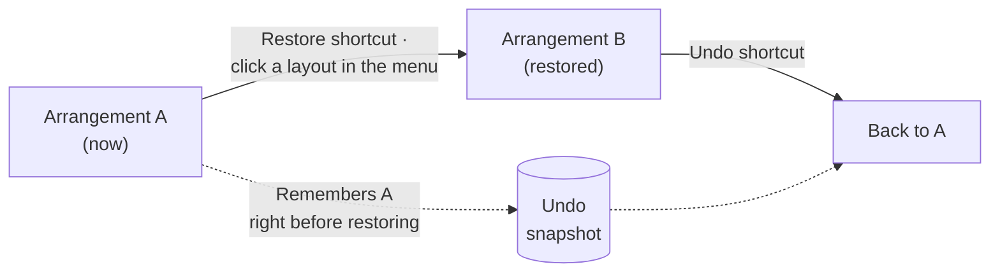

# Shortcut Usage

fWarrangeCli saves and restores window arrangements with **global shortcuts**. They work while you are in any other app, without opening the menu. Only the shortcuts written in the settings file `_config.yml` are registered, and you can change them from the file, the REST API, the command line, or the settings window of fWarrange (the GUI wrapper).

## The Five Shortcuts

| Action                     | `_config.yml` key        | Fresh install | What it does                                                      |
| -------------------------- | ------------------------ | ------------- | ----------------------------------------------------------------- |
| Save window layout         | `saveShortcut`           | `⌘F7`         | Saves the current arrangement as `YYYY-MM-DD-N`                   |
| Restore default layout     | `restoreDefaultShortcut` | `⇧⌘F7`        | Restores the default layout                                       |
| Restore last layout        | `restoreLastShortcut`    | `⌥⌘F7`        | Restores the most recently saved layout                           |
| Open fWarrange main window | `showMainWindowShortcut` | `⌃⇧⌘F7`       | Shows the main window of the GUI wrapper fWarrange                |
| Undo                       | `undoShortcut`           | (none)        | Cancels the last restore and returns to the arrangement before it |

* The menu bar menu shows the same shortcuts on the right. If a shortcut is missing from the menu, it is not registered
* Undo is off at first. To use it, assign a key as described in [Changing Shortcuts](#changing-shortcuts) (ex) `⌃⌘F7`)

## How Each Shortcut Behaves

### Save — `saveShortcut`

* The name is the date plus a daily sequence number — the first save today is `2026-10-09-1`, the next `2026-10-09-2`
* If no default layout exists yet, the layout you just saved becomes the **default layout**
* If another capture is in progress (ex) a capture via REST), this save is skipped
* To save under a name of your choice, use the CLI `capture <name>` or REST `POST /capture` — [REST API](05_API_Usage.md)

### Restore Default — `restoreDefaultShortcut`

* Restores the default layout (`defaultLayoutName` in `_config.yml`)
* If no default is set, or the default layout was deleted, restores the **most recently saved layout** instead
* If there are no saved layouts at all, nothing happens

### Restore Last — `restoreLastShortcut`

* Restores the layout file with the latest modification time — the **most recently saved** layout. It is not the layout you last *restored*

### Open Main Window — `showMainWindowShortcut`

* Opens fWarrange and shows its main window (URL Scheme `fwarrange://`)
* If fWarrange is not installed, the shortcut does nothing. Clicking **🖥️ Open Main Window** in the menu shows an App Store prompt instead
* It does not move windows, so it works without the Accessibility permission

### Undo — `undoShortcut`



* Remembers **one step only** — the arrangement right before a restore. A new restore overwrites it
* Only **shortcut restores** and **restores from clicking a layout in the menu** are remembered. Restores run from REST, the CLI, or fWarrange cannot be undone
* The snapshot lives in memory and is lost when fWarrangeCli restarts. Pressing Undo with nothing remembered does nothing
* Pressing Undo twice does not redo — it applies arrangement A once more

## Changing Shortcuts

| Method                         | Takes effect                      | Use when                            |
| ------------------------------ | --------------------------------- | ----------------------------------- |
| fWarrange Settings › Shortcuts | Immediately                       | Assigning keys by pressing them     |
| REST API                       | Immediately                       | Scripts · automation                |
| CLI `v2 shortcuts`             | Immediately                       | Quick changes from the terminal     |
| Editing `_config.yml`          | **After restarting fWarrangeCli** | Several keys at once, backup · sync |

### 1. Editing `_config.yml`

Open `~/Documents/finfra/fWarrangeData/_config.yml` with the menu **⚙️ Configuration ▸ Open Config File**.

```yaml
# Shortcuts (⌃=Control, ⌥=Option, ⇧=Shift, ⌘=Command)
saveShortcut: "⌘F7"
restoreDefaultShortcut: "⇧⌘F7"
restoreLastShortcut: "⌥⌘F7"
showMainWindowShortcut: "⌃⇧⌘F7"
undoShortcut: "⌃⌘F7"
```

* **Removing a line unregisters that shortcut.** Delete the whole line to turn a shortcut off
* Wrap the value in double quotes and do not add a `#` comment at the end of the line — the comment is read as part of the value and the shortcut is not registered
* The file is not re-read while running. After saving, restart fWarrangeCli

```bash
brew services restart fwarrange-cli
```

> **👻 Daemon ▸ Restart Daemon** in the menu restarts only the REST server. It does not re-read the settings file, so shortcut changes are not applied.

### 2. REST API

```bash
# Current shortcuts (unregistered ones are empty strings)
curl -s http://localhost:3016/api/v2/settings/shortcuts

# Change — only the keys you send change. null or "" clears; omitted keys stay as they are
curl -s -X PUT http://localhost:3016/api/v2/settings/shortcuts \
  -H "Content-Type: application/json" \
  -d '{"undoShortcut": "⌃⌘F7", "showMainWindowShortcut": null}'
```

* Changes are saved to `_config.yml` and the shortcuts are re-registered immediately. A `shortcuts.changed` event is recorded so fWarrange follows along
* A string that cannot be parsed is **ignored and the previous value is kept**. Check the values in the response to see what was actually applied
* Spec: `/settings/shortcuts` in [api/openapi_v2.yaml](../../api/openapi_v2.yaml)

### 3. Command Line

```bash
FWC=/opt/homebrew/opt/fwarrange-cli/fWarrangeCli.app/Contents/MacOS/fWarrangeCli

$FWC v2 shortcuts                                        # show
$FWC v2 shortcuts set '{"undoShortcut":"⌃⌘F7"}'          # change (same as REST PUT)
```

### 4. fWarrange Settings Window

With fWarrange installed, you can press keys to assign them in **Settings › Shortcuts**. Saving sends them to fWarrangeCli over REST and they take effect immediately — see the [fWarrange product page](https://finfra.kr/product/fWarrange/en/index.html).

## Notation

A shortcut is one string: **modifier symbols + key name**.

| Modifier | Symbol       |
| -------- | ------------ |
| Control  | `⌃` (or `^`) |
| Option   | `⌥`          |
| Shift    | `⇧`          |
| Command  | `⌘`          |

| Key type      | Name to write                                                                   |
| ------------- | ------------------------------------------------------------------------------- |
| Letters       | `A` – `Z` (case-insensitive)                                                    |
| Digits        | `0` – `9`                                                                       |
| Function keys | `F1` – `F15`                                                                    |
| Symbols       | `;` · `'` · `,` · `/` · `.`                                                     |
| Special keys  | `Space` · `↩`(Return) · `⇥`(Tab) · `⌫`(Delete) · `⌦`(Forward Delete) · `⎋`(Esc) |
| Arrows        | `←` · `→` · `↑` · `↓`                                                           |

* Modifier order does not matter. Values are saved in `⌃⌥⇧⌘` order — `⌘⇧F7` is saved as `⇧⌘F7`
* Keys not in the table (`-` · `=` · `[` · `]` · `\` · `` ` `` · numeric keypad) cannot be used
* A single key without modifiers is allowed (ex) `F7`), but it is captured in every app, so it is not recommended
* The legacy format `"98:1048576"` (key code:modifier value) is still read

## Permissions and Conflicts

* Registering shortcuts does not need the Accessibility permission. But **save · restore · undo** read and move windows, so they do. Pressed without the permission, they show a permission prompt and stop — [Installation › Accessibility Permission](02_Install.md#4-accessibility-permission)
* If another app or a macOS system shortcut uses the same combination, which one receives it is not guaranteed. Pick a combination nobody else uses. A shortcut that fails to register is logged as `등록 실패` (registration failed) — only recorded when `logLevel` in `_config.yml` is `3` or lower
* The `shortcut` field in a mode definition is only stored in the mode file; it is not registered as a global shortcut. Switch modes with the CLI `switch <mode>` or REST `POST /modes/{name}/activate` — [Functional Specification 5](../FunctionalSpecification.md#5-모드-mode)

## Troubleshooting

| Symptom                                                | Cause · Fix                                                                                                                                                       |
| ------------------------------------------------------ | ----------------------------------------------------------------------------------------------------------------------------------------------------------------- |
| Pressing the shortcut does nothing                     | Check that the menu shows it. If not, it is unregistered — add the line to `_config.yml` and restart                                                              |
| Edited `_config.yml` but nothing changed               | The file is not re-read while running — `brew services restart fwarrange-cli`                                                                                     |
| Only `showMainWindowShortcut` is not registered        | Check for a `#` comment at the end of the line. Remove it and restart (some installs ship an initial settings file with that comment)                             |
| The shortcut responds but windows don't move           | Accessibility permission is off — turn it back on and restart fWarrangeCli                                                                                        |
| Save/restore shortcuts vanished after a settings reset | The reset clears the four shortcuts and leaves only Undo at `⌃⌘F7` — write them back as in the [`_config.yml` example](#1-editing-_configyml) and restart         |
| Undo does nothing                                      | Nothing to undo — no restore from a shortcut or the menu yet, fWarrangeCli restarted, or the restore came from REST or fWarrange                                  |
| No shortcuts registered at all (development build)     | Check whether it runs with the environment variable `FWARRANGE_DISABLE_HOTKEYS=1` — `effectiveHotkeysEnabled: false` in `GET /api/v2/settings` means they are off |

## Next Steps

* [Menu Bar Usage](04_MenuBar_Usage.md) — menu · `_config.yml` · CLI
* [REST API Usage](05_API_Usage.md)
* [FAQ](08_FAQ.md)
