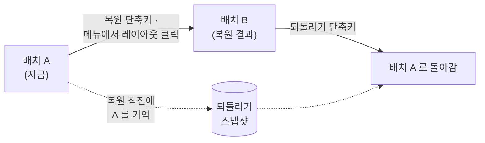

# 단축키 사용법

fWarrangeCli 는 **전역 단축키**로 창 배치를 저장하고 복원합니다. 다른 앱을 쓰는 중이어도, 메뉴를 열지 않아도 동작합니다. 단축키는 설정 파일 `_config.yml` 에 적힌 것만 등록되며, 파일 · REST API · 명령행 · fWarrange(GUI 래퍼) 설정 창 중 어디서든 바꿀 수 있습니다.

## 단축키 5종

| 동작                   | `_config.yml` 키         | 처음 설치 시 | 하는 일                                             |
| ---------------------- | ------------------------ | ------------ | --------------------------------------------------- |
| 창 레이아웃 저장       | `saveShortcut`           | `⌘F7`        | 지금 창 배치를 `YYYY-MM-DD-N` 이름으로 저장         |
| 기본 레이아웃 복구     | `restoreDefaultShortcut` | `⇧⌘F7`       | 기본 레이아웃으로 복원                              |
| 최근 레이아웃 복구     | `restoreLastShortcut`    | `⌥⌘F7`       | 가장 최근에 저장된 레이아웃으로 복원                |
| fWarrange 메인 창 열기 | `showMainWindowShortcut` | `⌃⇧⌘F7`      | GUI 래퍼 fWarrange 의 메인 창 표시                  |
| 되돌리기               | `undoShortcut`           | (없음)       | 직전 복원을 취소하고 복원하기 바로 전 배치로 되돌림 |

* 메뉴바 메뉴에도 같은 단축키가 오른쪽에 표시됩니다. 메뉴에 단축키가 안 보이면 그 단축키는 등록되지 않은 것입니다
* 되돌리기는 처음에 꺼져 있습니다. 쓰려면 [바꾸는 방법](#바꾸는-방법)으로 키를 지정합니다(ex) `⌃⌘F7`)

## 동작 세부

### 저장 — `saveShortcut`

* 이름은 날짜 + 당일 순번입니다 — 오늘 첫 저장은 `2026-10-09-1`, 다음은 `2026-10-09-2`
* 기본 레이아웃이 아직 없으면 이번에 저장한 레이아웃이 **기본 레이아웃**이 됩니다
* 다른 캡처가 진행 중이면(ex) REST 로 캡처 중) 이번 저장은 건너뜁니다
* 이름을 정해 저장하려면 명령행 `capture <이름>` 이나 REST `POST /capture` 를 씁니다 — [REST API](05_API_Usage.md)

### 기본 복구 — `restoreDefaultShortcut`

* 기본 레이아웃(`_config.yml` 의 `defaultLayoutName`)으로 복원합니다
* 기본 레이아웃이 지정되지 않았거나 지정된 레이아웃이 삭제되었으면 **가장 최근에 저장된 레이아웃**으로 복원합니다
* 저장된 레이아웃이 하나도 없으면 아무 일도 일어나지 않습니다

### 최근 복구 — `restoreLastShortcut`

* 레이아웃 파일 가운데 수정 시각이 가장 늦은 것, 즉 **가장 최근에 저장된** 레이아웃으로 복원합니다. 마지막으로 *복원했던* 레이아웃이 아닙니다

### 메인 창 열기 — `showMainWindowShortcut`

* fWarrange 를 열고 메인 창을 띄웁니다(URL Scheme `fwarrange://`)
* fWarrange 가 설치되어 있지 않으면 단축키로는 아무 일도 일어나지 않습니다. 메뉴의 **🖥️ 메인 창 열기** 를 누르면 App Store 안내 창이 나타납니다
* 창을 옮기지 않으므로 손쉬운 사용 권한이 없어도 동작합니다

### 되돌리기 — `undoShortcut`



* 복원하기 바로 전 배치를 **한 단계만** 기억합니다. 새로 복원하면 이전 기억은 덮어씁니다
* 기억이 생기는 것은 **단축키 복원**과 **메뉴에서 레이아웃을 클릭한 복원**뿐입니다. REST · 명령행 · fWarrange 에서 실행한 복원은 되돌리기 대상이 아닙니다
* 기억은 메모리에만 있어 fWarrangeCli 를 다시 시작하면 사라집니다. 기억이 없을 때 누르면 아무 일도 일어나지 않습니다
* 되돌리기를 두 번 눌러도 다시 복원(redo)되지 않습니다 — 같은 배치 A 를 한 번 더 적용합니다

## 바꾸는 방법

| 방법                    | 반영 시점                  | 이럴 때                        |
| ----------------------- | -------------------------- | ------------------------------ |
| fWarrange 설정 › 단축키 | 즉시                       | GUI 로 키를 눌러 지정할 때     |
| REST API                | 즉시                       | 스크립트 · 자동화              |
| 명령행 `v2 shortcuts`   | 즉시                       | 터미널에서 빠르게              |
| `_config.yml` 직접 편집 | **fWarrangeCli 재시작 후** | 여러 키를 한 번에, 백업·동기화 |

### 1. `_config.yml` 직접 편집

메뉴 **⚙️ 설정 ▸ 설정 파일 열기** 로 `~/Documents/finfra/fWarrangeData/_config.yml` 을 엽니다.

```yaml
# Shortcuts (⌃=Control, ⌥=Option, ⇧=Shift, ⌘=Command)
saveShortcut: "⌘F7"
restoreDefaultShortcut: "⇧⌘F7"
restoreLastShortcut: "⌥⌘F7"
showMainWindowShortcut: "⌃⇧⌘F7"
undoShortcut: "⌃⌘F7"
```

* **줄을 지우면 그 단축키는 등록되지 않습니다.** 끄고 싶은 단축키는 줄째 지웁니다
* 값은 큰따옴표로 감싸고, 줄 끝에 `#` 주석을 붙이지 않습니다 — 주석까지 값으로 읽혀 단축키가 등록되지 않습니다
* 파일은 실행 중에 다시 읽지 않습니다. 저장한 뒤 fWarrangeCli 를 다시 시작합니다

```bash
brew services restart fwarrange-cli
```

> 메뉴의 **👻 데몬 ▸ 데몬 재시작** 은 REST 서버만 다시 시작합니다. 설정 파일은 다시 읽지 않으므로 단축키 변경이 반영되지 않습니다.

### 2. REST API

```bash
# 현재 단축키 조회 (등록되지 않은 항목은 빈 문자열)
curl -s http://localhost:3016/api/v2/settings/shortcuts

# 바꾸기 — 적은 키만 바뀜. null 또는 "" 은 해제, 적지 않은 키는 그대로
curl -s -X PUT http://localhost:3016/api/v2/settings/shortcuts \
  -H "Content-Type: application/json" \
  -d '{"undoShortcut": "⌃⌘F7", "showMainWindowShortcut": null}'
```

* 바꾸면 `_config.yml` 에 저장되고 단축키가 즉시 다시 등록됩니다. 변경 이벤트 `shortcuts.changed` 가 기록되어 fWarrange 도 따라 갱신됩니다
* 해석할 수 없는 문자열은 **무시되고 이전 값이 유지됩니다**. 응답에 돌아온 값으로 실제 적용 결과를 확인합니다
* 스펙: [api/openapi_v2.yaml](../../api/openapi_v2.yaml) 의 `/settings/shortcuts`

### 3. 명령행

```bash
FWC=/opt/homebrew/opt/fwarrange-cli/fWarrangeCli.app/Contents/MacOS/fWarrangeCli

$FWC v2 shortcuts                                        # 조회
$FWC v2 shortcuts set '{"undoShortcut":"⌃⌘F7"}'          # 바꾸기 (REST PUT 과 같음)
```

### 4. fWarrange 설정 창

fWarrange 가 있으면 **설정 › 단축키** 탭에서 키를 직접 눌러 지정할 수 있습니다. 저장하면 REST 로 fWarrangeCli 에 전달되어 즉시 반영됩니다 — 사용법은 [fWarrange 안내 페이지](https://finfra.kr/product/fWarrange/kr/index.html).

## 표기 규칙

단축키는 **수정키 기호 + 키 이름** 하나의 문자열입니다.

| 수정키  | 기호           |
| ------- | -------------- |
| Control | `⌃` (또는 `^`) |
| Option  | `⌥`            |
| Shift   | `⇧`            |
| Command | `⌘`            |

| 키 종류 | 쓰는 이름                                                                       |
| ------- | ------------------------------------------------------------------------------- |
| 알파벳  | `A` ~ `Z` (대소문자 무관)                                                       |
| 숫자    | `0` ~ `9`                                                                       |
| 기능 키 | `F1` ~ `F15`                                                                    |
| 기호    | `;` · `'` · `,` · `/` · `.`                                                     |
| 특수 키 | `Space` · `↩`(Return) · `⇥`(Tab) · `⌫`(Delete) · `⌦`(Forward Delete) · `⎋`(Esc) |
| 화살표  | `←` · `→` · `↑` · `↓`                                                           |

* 수정키 순서는 상관없습니다. 저장할 때 `⌃⌥⇧⌘` 순서로 정리됩니다 — `⌘⇧F7` 은 `⇧⌘F7` 로 저장
* 위 표에 없는 키(`-` · `=` · `[` · `]` · `\` · `` ` `` · 숫자 키패드)는 쓸 수 없습니다
* 수정키 없이 키 하나만 지정할 수도 있지만(ex) `F7`), 그 키가 모든 앱에서 가로채이므로 권하지 않습니다
* 예전 형식 `"98:1048576"`(키 코드:수정키 값)도 읽을 수 있습니다

## 권한과 충돌

* 단축키 등록 자체는 손쉬운 사용 권한이 없어도 됩니다. 하지만 **저장 · 복구 · 되돌리기**는 창을 읽고 옮기므로 권한이 필요합니다. 권한 없이 누르면 권한 안내 창이 나타나고 동작은 중단됩니다 — [설치 › 손쉬운 사용 권한](02_Install.md#4-손쉬운-사용-권한)
* 같은 조합을 다른 앱이나 macOS 시스템 단축키가 쓰고 있으면 어느 쪽이 받을지 보장되지 않습니다. 겹치지 않는 조합을 고릅니다. 등록에 실패한 단축키는 로그에 `등록 실패` 로 남습니다(`_config.yml` 의 `logLevel` 을 `3` 이하로 두어야 기록됨)
* 모드 정의의 `shortcut` 필드는 모드 파일에 저장되는 값일 뿐, 전역 단축키로 등록되지 않습니다. 모드 전환은 명령행 `switch <모드>` 나 REST `POST /modes/{name}/activate` 로 합니다 — [기능 명세 5](../FunctionalSpecification.md#5-모드-mode)

## 문제 해결

| 증상                                     | 원인 · 조치                                                                                                                               |
| ---------------------------------------- | ----------------------------------------------------------------------------------------------------------------------------------------- |
| 단축키를 눌러도 반응이 없음              | 메뉴에 그 단축키가 표시되는지 확인. 없으면 미등록 — `_config.yml` 에 줄을 넣고 재시작                                                     |
| `_config.yml` 을 고쳤는데 그대로         | 실행 중에는 파일을 다시 읽지 않음 — `brew services restart fwarrange-cli`                                                                 |
| `showMainWindowShortcut` 만 등록이 안 됨 | 줄 끝에 `#` 주석이 붙어 있는지 확인. 주석을 지우고 재시작 (일부 설치본의 초기 설정 파일에 주석이 붙어 있음)                               |
| 단축키는 반응하는데 창이 안 움직임       | 손쉬운 사용 권한이 꺼짐 — 권한을 다시 켜고 fWarrangeCli 재시작                                                                            |
| 설정 초기화 뒤 저장·복구 단축키가 사라짐 | 초기화는 단축키 4종을 비우고 되돌리기만 `⌃⌘F7` 로 둠 — 위 [`_config.yml` 예시](#1-_configyml-직접-편집)대로 다시 적고 재시작              |
| 되돌리기가 아무 일도 안 함               | 되돌릴 기억이 없음 — 단축키·메뉴로 복원한 적이 없거나, 재시작했거나, REST·fWarrange 로 복원한 경우                                        |
| 단축키가 전혀 등록되지 않음(개발 빌드)   | 환경 변수 `FWARRANGE_DISABLE_HOTKEYS=1` 로 실행 중인지 확인 — `GET /api/v2/settings` 의 `effectiveHotkeysEnabled` 가 `false` 면 꺼진 상태 |

## 다음 단계

* [메뉴바 사용법](04_MenuBar_Usage.md) — 메뉴 · `_config.yml` · 명령행
* [REST API 사용법](05_API_Usage.md)
* [FAQ](08_FAQ.md)
